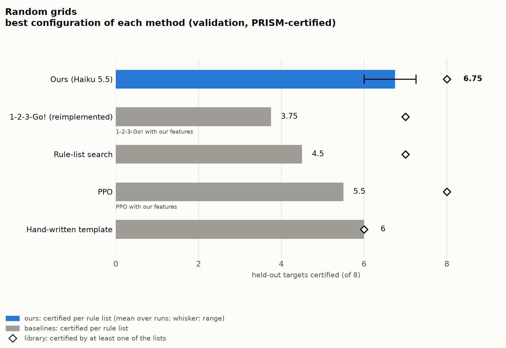
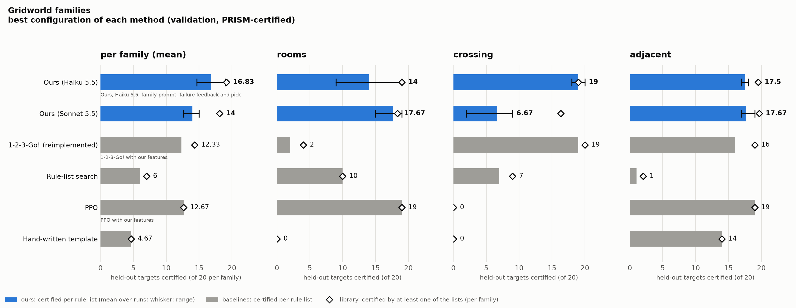
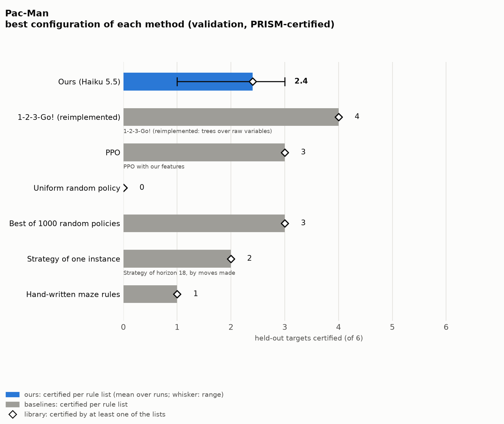
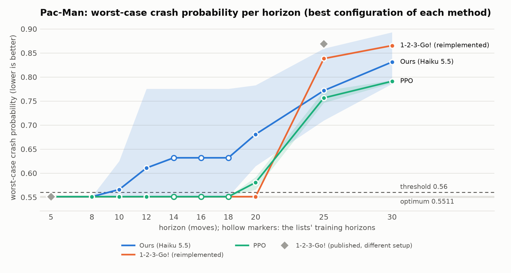
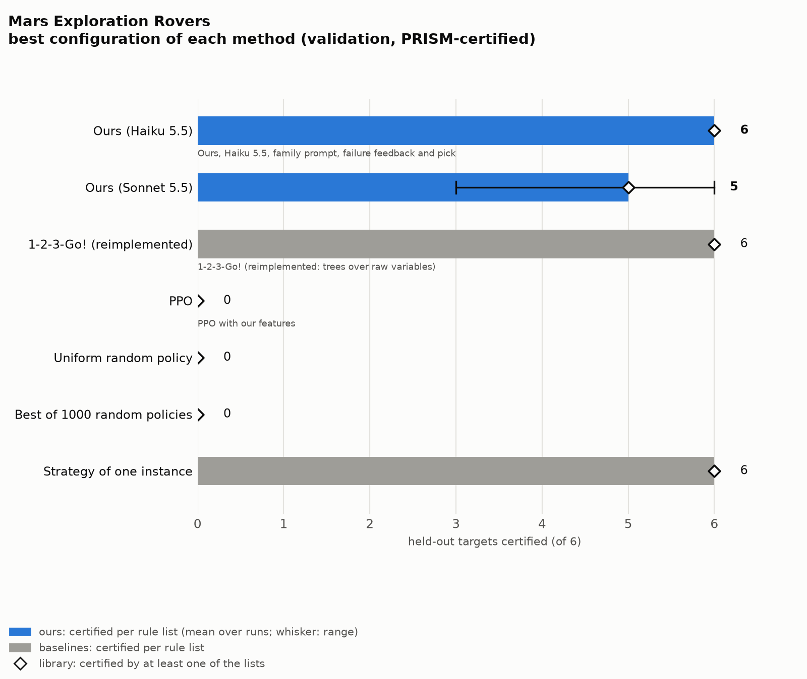
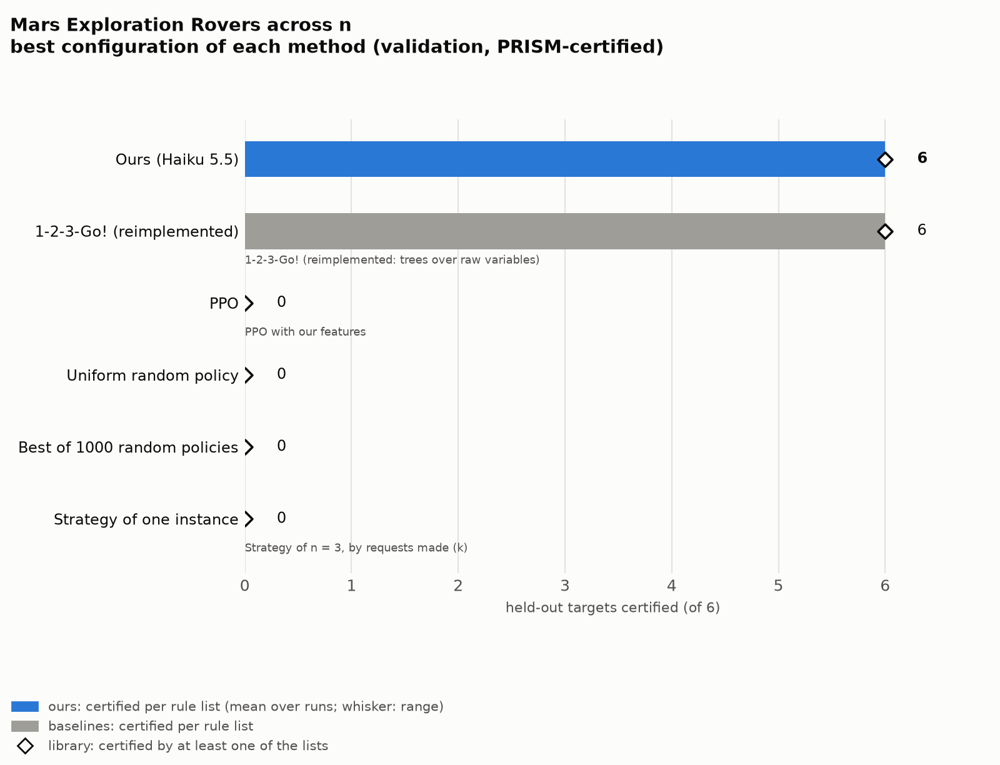
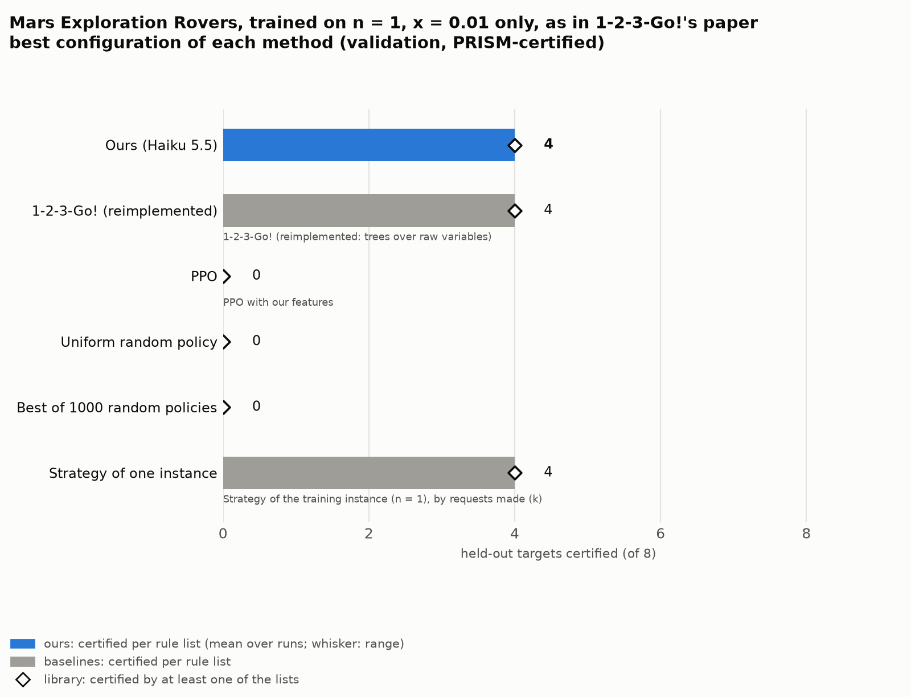
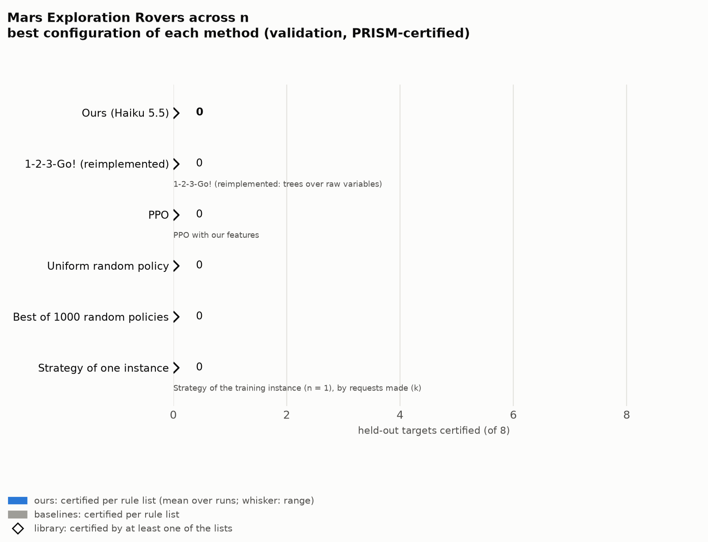

# RQ1: LLM-written rule lists against the baselines (validation)

How many held-out instances does one frozen rule list certify, per method, and how many does a library of a run's lists cover? Ours is the core configuration, the loop rebuilt on Oct 16 (the `port_*` conditions): features and goal flags only in conditions, the worst case spelled out, feedback on every training member's failures, eight independent chains, a final pick by members passed and margin, `any` left open in the loop and resolved once by the pick (Pac-Man: then narrowed by the verifier). The previous loop is compared in rq2_previous_loop.

Certified: held-out targets certified per rule list (on its own group's targets where there are groups). Every target: the same over all targets, whatever the group. Library: targets certified by at least one of a run's (or baseline's) lists. Ties open: certified with the action orders left open, i.e. however ties are broken. Ours: mean over runs, range in parentheses.

**Best configuration per method** (✓, the only one in the figures): per benchmark, the method's configuration with the highest mean certified per list on these validation targets; ties: the larger library, then the lower cost. Only fully certified configurations compete. The test pass uses the configurations chosen here (`chosen.csv`) and never re-chooses on test results.

## Random grids (grid_20_large; trained on sets of three 9x9-13x13 grids, held out: 12-19)

Targets 12-19: 8 held out (each list's own training instances are left out).

| method | configuration | figure | runs | certified | every target | best list | library | ties open | sets solved | $ / set |
|---|---|---|---|---|---|---|---|---|---|---|
| Ours (Haiku 5.5) | **Ours, Haiku 5.5** | ✓ | 3 | 6.75 (6.00–7.25) | 6.75 (6.00–7.25) | 8 (7–8) | 8.0 | 6.50 (6.00–6.75) | 75% | 0.102 (0.100–0.105) |
| 1-2-3-Go! (reimplemented) | 1-2-3-Go! (reimplemented: trees over raw variables) |  | – | 0.00 | 0.00 | 0 | 0.0 | 0.00 | – | – |
| 1-2-3-Go! (reimplemented) | 1-2-3-Go! with our features | ✓ | – | 3.75 | 3.75 | 7 | 7.0 | 3.75 | – | – |
| Rule-list search | Rule-list search | ✓ | – | 4.50 | 4.50 | 7 | 7.0 | 2.75 | – | – |
| PPO | PPO with our features | ✓ | – | 5.50 | 5.50 | 7 | 8.0 | 5.50 | – | – |
| PPO | PPO with a MiniGrid-style local view |  | – | 0.75 | 0.75 | 2 | 2.0 | 0.75 | – | – |
| Hand-written template | Hand-written template | ✓ | – | 6.00 | 6.00 | 6 | 6.0 | 6.00 | – | – |

## Random grids without the shortest-path feature `closer`

Targets 12-19: 8 held out (each list's own training instances are left out).

| method | configuration | figure | runs | certified | every target | best list | library | ties open | sets solved | $ / set |
|---|---|---|---|---|---|---|---|---|---|---|
| Ours (Haiku 5.5) | **Ours, Haiku 5.5** | ✓ | 1 | 3.25 | 3.25 | 4 | 6.0 | 3.25 | 50% | 0.101 |
| 1-2-3-Go! (reimplemented) | 1-2-3-Go! with our features | ✓ | – | 1.50 | 1.50 | 2 | 3.0 | 1.50 | – | – |
| Rule-list search | Rule-list search | ✓ | – | 1.25 | 1.25 | 2 | 2.0 | 0.50 | – | – |
| Hand-written template | Hand-written template | ✓ | – | 6.00 | 6.00 | 6 | 6.0 | 6.00 | – | – |

## Gridworld families (trained on three 6x6-8x8 members of a family, held out: 10x10-14x14 members)

Targets 16-35,76-95,136-155: 60 held out (each list's own training instances are left out).

| method | configuration | figure | runs | certified | every target | best list | library | ties open | sets solved | $ / set |
|---|---|---|---|---|---|---|---|---|---|---|
| Ours (Haiku 5.5) | **Ours, Haiku 5.5** | ✓ | 3 | 17.44 (14.67–19.00) | 31.00 (29.33–32.00) | 19 (18–20) | 58.3 (56.0–60.0) | 16.33 (13.33–18.33) | 100% | 0.074 (0.072–0.077) |
| 1-2-3-Go! (reimplemented) | 1-2-3-Go! (reimplemented: trees over raw variables) |  | – | 0.00 | 0.00 | 0 | 0.0 | 0.00 | – | – |
| 1-2-3-Go! (reimplemented) | 1-2-3-Go! with our features | ✓ | – | 12.33 | 20.33 | 19 | 43.0 | 12.33 | – | – |
| Rule-list search | Rule-list search | ✓ | – | 6.00 | 11.00 | 10 | 21.0 | 3.00 | – | – |
| PPO | PPO with our features | ✓ | – | 12.67 | 16.67 | 19 | 38.0 | 12.67 | – | – |
| PPO | PPO with a MiniGrid-style local view |  | – | 1.33 | 1.33 | 4 | 4.0 | 1.33 | – | – |
| Hand-written template | Hand-written template | ✓ | – | 4.67 | 14.00 | 14 | 14.0 | 4.67 | – | – |

Per group (certified per rule list on its own group):

| configuration | rooms (of 20) | crossing (of 20) | adjacent (of 20) |
|---|---|---|---|
| Ours, Haiku 5.5 | 16.0 | 18.3 | 18.0 |
| 1-2-3-Go! (reimplemented: trees over raw variables) | 0.0 | 0.0 | 0.0 |
| 1-2-3-Go! with our features | 2.0 | 19.0 | 16.0 |
| Rule-list search | 10.0 | 7.0 | 1.0 |
| PPO with our features | 19.0 | 0.0 | 19.0 |
| PPO with a MiniGrid-style local view | 4.0 | 0.0 | 0.0 |
| Hand-written template | 0.0 | 0.0 | 14.0 |

## Pac-Man (trained on horizons 14, 16, 18; 6 held out: 8, 10, 12, 20, 25, 30)

Targets 0-7,9: 6 held out (each list's own training instances are left out).

| method | configuration | figure | runs | certified | every target | best list | library | ties open | sets solved | $ / set |
|---|---|---|---|---|---|---|---|---|---|---|
| Ours (Haiku 5.5) | **Ours, Haiku 5.5** | ✓ | 3 | 4.00 | 4.00 | 4 | 4.0 | – | 100% | 0.098 (0.093–0.103) |
| 1-2-3-Go! (reimplemented) | 1-2-3-Go! (reimplemented: trees over raw variables) | ✓ | – | 4.00 | 4.00 | 4 | 4.0 | 4.00 | – | – |
| 1-2-3-Go! (reimplemented) | 1-2-3-Go! trained on horizon 5 (as the paper) |  | – | 2.00 | 2.00 | 2 | 2.0 | 2.00 | – | – |
| 1-2-3-Go! (reimplemented) | 1-2-3-Go! with our features |  | – | 2.00 | 2.00 | 2 | 2.0 | 2.00 | – | – |
| 1-2-3-Go! (reimplemented) | 1-2-3-Go! with our features, trained on horizon 5 |  | – | 0.00 | 0.00 | 0 | 0.0 | 0.00 | – | – |
| 1-2-3-Go! (reimplemented) | 1-2-3-Go! with our features and positions |  | – | 3.00 | 3.00 | 3 | 3.0 | 3.00 | – | – |
| PPO | PPO with our features | ✓ | – | 3.00 | 3.00 | 3 | 3.0 | 3.00 | – | – |
| PPO | PPO over raw variables |  | – | 3.00 | 3.00 | 3 | 3.0 | 3.00 | – | – |
| PPO | PPO with our features and positions |  | – | 3.00 | 3.00 | 3 | 3.0 | 3.00 | – | – |
| Uniform random policy | Uniform random policy | ✓ | – | 0.00 | 0.00 | 0 | 0.0 | 0.00 | – | – |
| Best of 1000 random policies | Best of 1000 random policies | ✓ | – | 3.00 | 3.00 | 3 | 3.0 | 3.00 | – | – |
| Strategy of one instance | Strategy of horizon 18, by moves made | ✓ | – | 2.00 | 2.00 | 2 | 2.0 | 2.00 | – | – |
| Strategy of one instance | Strategy of horizon 18, by moves left |  | – | 0.00 | 0.00 | 0 | 0.0 | 0.00 | – | – |
| Hand-written maze rules | Hand-written maze rules | ✓ | – | 1.00 | 1.00 | 1 | 1.0 | 1.00 | – | – |

Worst-case crash of each method's frozen lists (best configuration) per horizon, up to 30: horizons 50 and 100 are Pac-Man's sealed test set and stay out until the test pass (200: PRISM cannot build it). Line: mean over the lists, band: their range; hollow markers: a list's own training horizons. 1-2-3-Go! (published, different setup): 0.5511 at 5, 0.869 at 25, 0.99998 at 200 (200 beyond the axis). The figure shows Ours (Haiku 5.5), 1-2-3-Go! (reimplemented), PPO; the other methods are in the table above.

## Mars Exploration Rovers (trained on x = 0.01, 0.05, 0.13 at n = 10; 6 held out: x = 0.03, 0.08, 0.21, 0.34; n = 1, 20)

Targets 0-8: 6 held out (each list's own training instances are left out).

| method | configuration | figure | runs | certified | every target | best list | library | ties open | sets solved | $ / set |
|---|---|---|---|---|---|---|---|---|---|---|
| Ours (Haiku 5.5) | **Ours, Haiku 5.5** | ✓ | 3 | 6.00 | 6.00 | 6 | 6.0 | 6.00 | 100% | 0.337 (0.296–0.366) |
| 1-2-3-Go! (reimplemented) | 1-2-3-Go! (reimplemented: trees over raw variables) | ✓ | – | 6.00 | 6.00 | 6 | 6.0 | 6.00 | – | – |
| 1-2-3-Go! (reimplemented) | 1-2-3-Go! trained on n = 1 (as the paper) |  | – | 2.00 | 2.00 | 2 | 2.0 | 2.00 | – | – |
| 1-2-3-Go! (reimplemented) | 1-2-3-Go! with our features |  | – | 3.00 | 3.00 | 3 | 3.0 | 3.00 | – | – |
| PPO | PPO with our features | ✓ | – | 0.00 | 0.00 | 0 | 0.0 | 0.00 | – | – |
| PPO | PPO over raw variables |  | – | 0.00 | 0.00 | 0 | 0.0 | 0.00 | – | – |
| Uniform random policy | Uniform random policy | ✓ | – | 0.00 | 0.00 | 0 | 0.0 | 0.00 | – | – |
| Best of 1000 random policies | Best of 1000 random policies | ✓ | – | 0.00 | 0.00 | 0 | 0.0 | 0.00 | – | – |
| Strategy of one instance | Strategy of x = 0.13 | ✓ | – | 6.00 | 6.00 | 6 | 6.0 | 6.00 | – | – |

## Mars Exploration Rovers across n (x = 0.89; trained on n = 1, 2, 3; 6 held out: n = 4, 5, 6, 8, 10, 15)

Targets 0-8: 6 held out (each list's own training instances are left out).

| method | configuration | figure | runs | certified | every target | best list | library | ties open | sets solved | $ / set |
|---|---|---|---|---|---|---|---|---|---|---|
| Ours (Haiku 5.5) | **Ours, Haiku 5.5** | ✓ | 3 | 6.00 | 6.00 | 6 | 6.0 | 6.00 | 100% | 0.370 (0.258–0.484) |
| 1-2-3-Go! (reimplemented) | 1-2-3-Go! (reimplemented: trees over raw variables) | ✓ | – | 6.00 | 6.00 | 6 | 6.0 | 6.00 | – | – |
| 1-2-3-Go! (reimplemented) | 1-2-3-Go! trained on n = 1 (as the paper) |  | – | 0.00 | 0.00 | 0 | 0.0 | 0.00 | – | – |
| 1-2-3-Go! (reimplemented) | 1-2-3-Go! with our features |  | – | 0.00 | 0.00 | 0 | 0.0 | 0.00 | – | – |
| PPO | PPO with our features | ✓ | – | 0.00 | 0.00 | 0 | 0.0 | 0.00 | – | – |
| PPO | PPO over raw variables |  | – | 0.00 | 0.00 | 0 | 0.0 | 0.00 | – | – |
| Uniform random policy | Uniform random policy | ✓ | – | 0.00 | 0.00 | 0 | 0.0 | 0.00 | – | – |
| Best of 1000 random policies | Best of 1000 random policies | ✓ | – | 0.00 | 0.00 | 0 | 0.0 | 0.00 | – | – |
| Strategy of one instance | Strategy of n = 3, by requests made (k) | ✓ | – | 0.00 | 0.00 | 0 | 0.0 | 0.00 | – | – |
| Strategy of one instance | Strategy of n = 3, by requests left |  | – | 0.00 | 0.00 | 0 | 0.0 | 0.00 | – | – |

## Mars Exploration Rovers, trained on n = 1, x = 0.01 only, as in 1-2-3-Go!'s paper (8 held out: x = 0.01, 0.03, 0.05, 0.08, 0.13, 0.21, 0.34 at n = 10; n = 20)

Targets 0-8: 8 held out (each list's own training instances are left out).

| method | configuration | figure | runs | certified | every target | best list | library | ties open | sets solved | $ / set |
|---|---|---|---|---|---|---|---|---|---|---|
| Ours (Haiku 5.5) | **Ours, Haiku 5.5** | ✓ | 3 | 4.00 | 4.00 | 4 | 4.0 | 4.00 | 100% | 0.161 (0.113–0.237) |
| 1-2-3-Go! (reimplemented) | 1-2-3-Go! (reimplemented: trees over raw variables) | ✓ | – | 4.00 | 4.00 | 4 | 4.0 | 4.00 | – | – |
| 1-2-3-Go! (reimplemented) | 1-2-3-Go! with our features |  | – | 4.00 | 4.00 | 4 | 4.0 | 4.00 | – | – |
| PPO | PPO with our features | ✓ | – | 0.00 | 0.00 | 0 | 0.0 | 0.00 | – | – |
| PPO | PPO over raw variables |  | – | 0.00 | 0.00 | 0 | 0.0 | 0.00 | – | – |
| Uniform random policy | Uniform random policy | ✓ | – | 0.00 | 0.00 | 0 | 0.0 | 0.00 | – | – |
| Best of 1000 random policies | Best of 1000 random policies | ✓ | – | 0.00 | 0.00 | 0 | 0.0 | 0.00 | – | – |
| Strategy of one instance | Strategy of the training instance (n = 1), by requests made (k) | ✓ | – | 4.00 | 4.00 | 4 | 4.0 | 4.00 | – | – |
| Strategy of one instance | Strategy of the training instance (n = 1), by requests left |  | – | 0.00 | 0.00 | 0 | 0.0 | 0.00 | – | – |

## Mars Exploration Rovers across n (x = 0.89), trained on n = 1 only, as in 1-2-3-Go!'s paper (8 held out: n = 2, 3, 4, 5, 6, 8, 10, 15)

Targets 0-8: 8 held out (each list's own training instances are left out).

| method | configuration | figure | runs | certified | every target | best list | library | ties open | sets solved | $ / set |
|---|---|---|---|---|---|---|---|---|---|---|
| Ours (Haiku 5.5) | **Ours, Haiku 5.5** | ✓ | 3 | 0.00 | 0.00 | 0 | 0.0 | 0.00 | 100% | 0.130 (0.094–0.177) |
| 1-2-3-Go! (reimplemented) | 1-2-3-Go! (reimplemented: trees over raw variables) | ✓ | – | 0.00 | 0.00 | 0 | 0.0 | 0.00 | – | – |
| 1-2-3-Go! (reimplemented) | 1-2-3-Go! with our features |  | – | 0.00 | 0.00 | 0 | 0.0 | 0.00 | – | – |
| PPO | PPO with our features | ✓ | – | 0.00 | 0.00 | 0 | 0.0 | 0.00 | – | – |
| PPO | PPO over raw variables |  | – | 0.00 | 0.00 | 0 | 0.0 | 0.00 | – | – |
| Uniform random policy | Uniform random policy | ✓ | – | 0.00 | 0.00 | 0 | 0.0 | 0.00 | – | – |
| Best of 1000 random policies | Best of 1000 random policies | ✓ | – | 0.00 | 0.00 | 0 | 0.0 | 0.00 | – | – |
| Strategy of one instance | Strategy of the training instance (n = 1), by requests made (k) | ✓ | – | 0.00 | 0.00 | 0 | 0.0 | 0.00 | – | – |
| Strategy of one instance | Strategy of the training instance (n = 1), by requests left |  | – | 0.00 | 0.00 | 0 | 0.0 | 0.00 | – | – |

