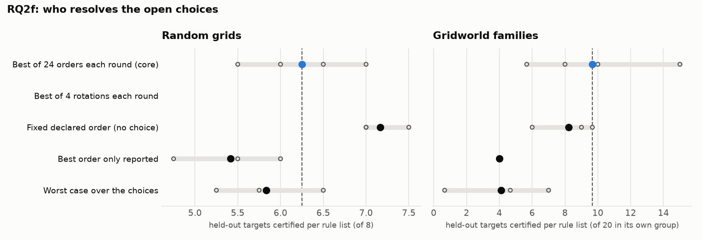

# RQ2f: who resolves the open choices

How much does the verifier's choice of action order contribute, during training, to rules that transfer?

Reference: **Best of 24 orders each round (core)**. Certified: held-out targets certified per rule list (mean over runs, range over runs). Δ: difference of means to the reference, with a 90% bootstrap interval over runs (few runs: read it as a rough guide). Ties open: certified with the action orders left open, i.e. however ties are broken. Library: targets certified by at least one of a run's lists.

## Random grids

Targets 12-19 (each list's own training instances left out); certified of 8.

| condition | code | runs | certified | Δ vs reference | ties open | library | sets solved | rounds / set | output tokens / set |
|---|---|---|---|---|---|---|---|---|---|
| Best of 24 orders each round (core) | All 24 | 5 | 6.25 (5.50–7.00) | reference | 5.50 (5.00–6.25) | 8.0 | 10% (0%–25%) | 4.9 (4.5–5.0) | 11,315 (8,570–15,009) |
| Best of 4 rotations each round | Rotations | 0 | – | – | – | – | – | – | – |
| Fixed declared order (no choice) | Declared | 3 | 7.17 (7.00–7.50) | +0.92 [+0.50, +1.33] | – | 8.0 | 0% | 5.0 | 12,256 (11,178–13,929) |
| Best order only reported | Report | 3 | 5.42 (4.75–6.00) | -0.83 [-1.45, -0.23] | – | 7.3 (7.0–8.0) | 0% | 5.0 | 8,440 (7,243–9,076) |
| Worst case over the choices | None | 3 | 5.83 (5.25–6.50) | -0.42 [-1.02, +0.20] | – | 6.7 (6.0–7.0) | 0% | 5.0 | 8,643 (6,348–10,486) |

## Gridworld families

Targets 16-35,76-95,136-155 (each list's own training instances left out); certified of 20 in its own group.

| condition | code | runs | certified | Δ vs reference | ties open | library | sets solved | rounds / set | output tokens / set |
|---|---|---|---|---|---|---|---|---|---|
| Best of 24 orders each round (core) | All 24 | 5 | 9.67 (5.67–15.00) | reference | – | 33.8 (24.0–56.0) | 40% (33%–67%) | 3.9 (3.7–4.3) | 9,947 (7,662–15,685) |
| Best of 4 rotations each round | Rotations | 0 | – | – | – | – | – | – | – |
| Fixed declared order (no choice) | Declared | 3 | 8.22 (6.00–9.67) | -1.44 [-4.31, +1.18] | – | 28.0 (25.0–30.0) | 44% (33%–67%) | 4.2 (4.0–4.7) | 11,279 (7,108–15,558) |
| Best order only reported | Report | 3 | 4.00 | -5.67 [-7.93, -3.47] | – | 14.0 (12.0–16.0) | 33% | 4.0 | 7,540 (6,638–9,156) |
| Worst case over the choices | None | 3 | 4.11 (0.67–7.00) | -5.56 [-9.00, -2.33] | – | 13.3 (5.0–21.0) | 22% (0%–33%) | 4.4 (4.0–5.0) | 8,816 (7,964–10,379) |

Per group (certified per rule list on its own group, mean over runs):

| condition | rooms | crossing | adjacent |
|---|---|---|---|
| Best of 24 orders each round (core) | 8.4 | 4.6 | 16.0 |
| Best of 4 rotations each round | – | – | – |
| Fixed declared order (no choice) | 7.0 | 1.3 | 16.3 |
| Best order only reported | 0.0 | 0.0 | 12.0 |
| Worst case over the choices | 2.7 | 0.0 | 9.7 |

