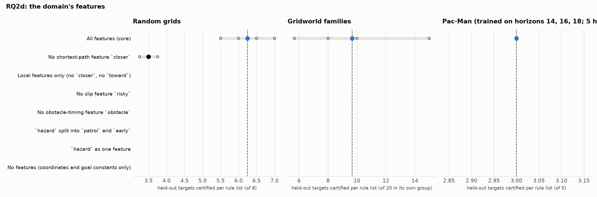

# RQ2d: the domain's features

How much does the rules' transfer depend on the features the domain provides?

Reference: **All features (core)**. Certified: held-out targets certified per rule list (mean over runs, range over runs). Δ: difference of means to the reference, with a 90% bootstrap interval over runs (few runs: read it as a rough guide). Ties open: certified with the action orders left open, i.e. however ties are broken. Library: targets certified by at least one of a run's lists.

## Random grids

Targets 12-19 (each list's own training instances left out); certified of 8.

| condition | code | runs | certified | Δ vs reference | ties open | library | sets solved | rounds / set | output tokens / set |
|---|---|---|---|---|---|---|---|---|---|
| All features (core) | All | 5 | 6.25 (5.50–7.00) | reference | 5.50 (5.00–6.25) | 8.0 | 10% (0%–25%) | 4.9 (4.5–5.0) | 11,315 (8,570–15,009) |
| No shortest-path feature `closer` | -closer | 3 | 3.50 (3.25–3.75) | -2.75 [-3.17, -2.33] | 0.00 | 6.3 (5.0–7.0) | 0% | 5.0 | 13,460 (12,539–13,964) |
| Local features only (no `closer`, no `toward`) | Local | 0 | – | – | – | – | – | – | – |
| No slip feature `risky` | -risky | 0 | – | – | – | – | – | – | – |
| No obstacle-timing feature `obstacle` | -obstacle | 0 | – | – | – | – | – | – | – |
| `hazard` split into `patrol` and `early` | Split | 0 | – | – | – | – | – | – | – |
| No features (coordinates and goal constants only) | None | 0 | – | – | – | – | – | – | – |

## Gridworld families

Targets 16-35,76-95,136-155 (each list's own training instances left out); certified of 20 in its own group.

| condition | code | runs | certified | Δ vs reference | ties open | library | sets solved | rounds / set | output tokens / set |
|---|---|---|---|---|---|---|---|---|---|
| All features (core) | All | 5 | 9.67 (5.67–15.00) | reference | – | 33.8 (24.0–56.0) | 40% (33%–67%) | 3.9 (3.7–4.3) | 9,947 (7,662–15,685) |
| No shortest-path feature `closer` | -closer | 0 | – | – | – | – | – | – | – |
| Local features only (no `closer`, no `toward`) | Local | 0 | – | – | – | – | – | – | – |
| No slip feature `risky` | -risky | 0 | – | – | – | – | – | – | – |
| No obstacle-timing feature `obstacle` | -obstacle | 0 | – | – | – | – | – | – | – |
| `hazard` as one feature | Unsplit | 0 | – | – | – | – | – | – | – |
| No features (coordinates and goal constants only) | None | 0 | – | – | – | – | – | – | – |

Per group (certified per rule list on its own group, mean over runs):

| condition | rooms | crossing | adjacent |
|---|---|---|---|
| All features (core) | 8.4 | 4.6 | 16.0 |
| No shortest-path feature `closer` | – | – | – |
| Local features only (no `closer`, no `toward`) | – | – | – |
| No slip feature `risky` | – | – | – |
| No obstacle-timing feature `obstacle` | – | – | – |
| `hazard` as one feature | – | – | – |
| No features (coordinates and goal constants only) | – | – | – |

## Pac-Man (trained on horizons 14, 16, 18; 5 held out: 8, 10, 12, 20, 25)

Targets 0-7 (each list's own training instances left out); certified of 5.

| condition | code | runs | certified | Δ vs reference | ties open | library | sets solved | rounds / set | output tokens / set |
|---|---|---|---|---|---|---|---|---|---|
| All features (core) | All | 3 | 3.00 | reference | – | 3.0 | 67% (0%–100%) | 4.0 (3.0–5.0) | 4,649 (3,555–6,328) |

