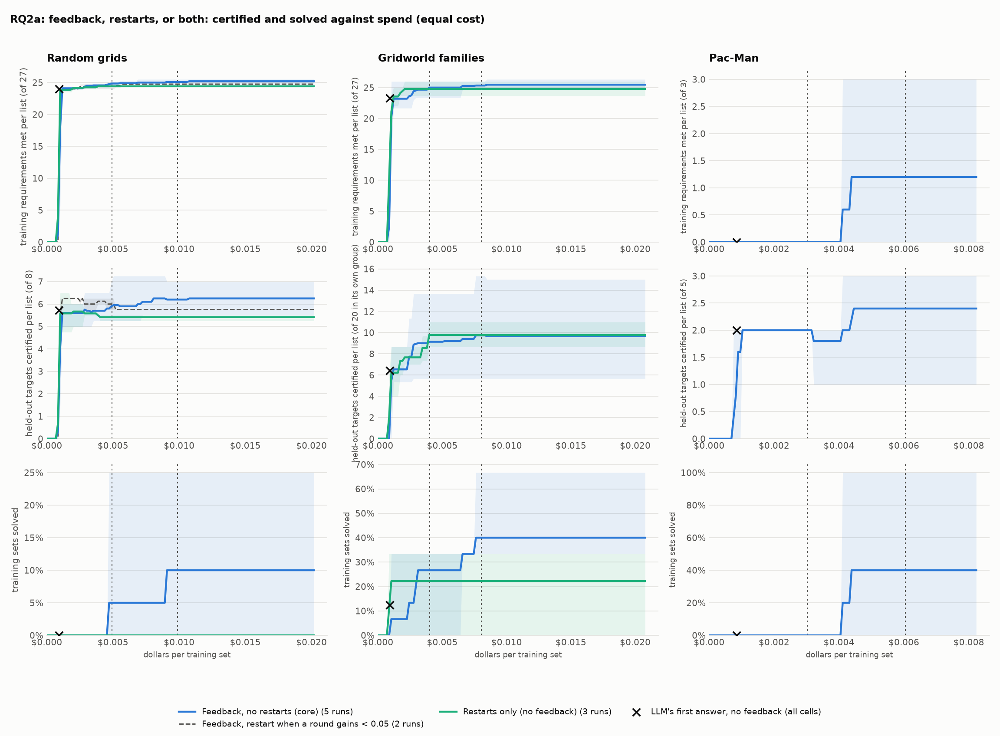
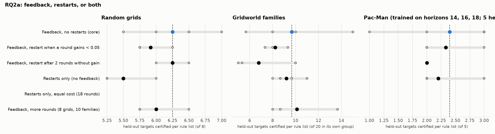

# RQ2a: feedback, restarts, or both

Each round either refines the rule list with the verifier's feedback or starts over from the initial prompt; the best list so far is kept either way. Restarts only sends the initial prompt every round, byte for byte, with nothing from earlier rounds (checked in the `llm_tasks.jsonl` of its six runs; round 1 of every cell is that same prompt). In every cell the verifier still resolves `any` rules into the action order that does best on the training members, and keep-best still applies: both arms share those two roles of the verifier, and differ only in whether the next prompt carries its feedback. Feedback rounds cost more (longer prompts, about 3.4 times the output tokens), so equal rounds is not equal cost: the question is settled at equal cost, by three comparisons fixed before the equal-cost runs, on every benchmark: feedback with no restarts against restarts only at equal cost, in (a) held-out targets certified per list at feedback's mean spend after its 5 rounds, (b) the same at half that spend, and (c) training sets solved at feedback's mean spend.

## Planned comparisons: feedback against restarts at equal cost

Fixed before the equal-cost runs (plan 03): feedback with no restarts against restarts only at equal cost, on every benchmark. Budgets are per training set, in dollars at the prices above, as multiples of feedback's mean spend after its 5 rounds. Keep-best makes every curve rise, so only the comparison at equal spend is evidence; any other reading of the figure is exploratory.

Δ = **Feedback, no restarts (core)** minus the other cell, each run read at the given budget per training set (the list keep-best holds after its last round within the budget; dollars at the prices above). Interval: 95% bootstrap over runs; p: two-sided bootstrap; p (Holm): corrected over all 9 comparisons together; below 0.05 counts.

| benchmark | comparison | against | budget | runs | reference | other | Δ [interval] | p | p (Holm) |
|---|---|---|---|---|---|---|---|---|---|
| Random grids | (a) certified per list at feedback's spend | Restarts only, equal cost (18 rounds) | $0.0099 | 5 v 0 | 6.20 | – | – | – | – |
| Random grids | (b) certified per list at half of feedback's spend | Restarts only, equal cost (18 rounds) | $0.0049 | 5 v 0 | 5.95 | – | – | – | – |
| Random grids | (c) training sets solved at feedback's spend | Restarts only, equal cost (18 rounds) | $0.0099 | 5 v 0 | 10% | – | – | – | – |
| Gridworld families | (a) certified per list at feedback's spend | Restarts only, equal cost (18 rounds) | $0.0080 | 5 v 0 | 9.73 | – | – | – | – |
| Gridworld families | (b) certified per list at half of feedback's spend | Restarts only, equal cost (18 rounds) | $0.0040 | 5 v 0 | 9.13 | – | – | – | – |
| Gridworld families | (c) training sets solved at feedback's spend | Restarts only, equal cost (18 rounds) | $0.0080 | 5 v 0 | 40% | – | – | – | – |
| Pac-Man (trained on horizons 14, 16, 18; 5 held out: 8, 10, 12, 20, 25) | (a) certified per list at feedback's spend | Restarts only, equal cost (18 rounds) | $0.0060 | 5 v 0 | 2.40 | – | – | – | – |
| Pac-Man (trained on horizons 14, 16, 18; 5 held out: 8, 10, 12, 20, 25) | (b) certified per list at half of feedback's spend | Restarts only, equal cost (18 rounds) | $0.0030 | 5 v 0 | 2.00 | – | – | – | – |
| Pac-Man (trained on horizons 14, 16, 18; 5 held out: 8, 10, 12, 20, 25) | (c) training sets solved at feedback's spend | Restarts only, equal cost (18 rounds) | $0.0060 | 5 v 0 | 40% | – | – | – | – |

The LLM's first answer (round 1, before any feedback; the same initial prompt in every cell, so pooled over all their lists): an "LLM alone" point.

| benchmark | lists | certified per list | sets solved | dollars per set |
|---|---|---|---|---|
| Random grids | 40 | 5.72 | 0% | $0.0009 |
| Gridworld families | 24 | 6.42 | 12% | $0.0009 |
| Pac-Man (trained on horizons 14, 16, 18; 5 held out: 8, 10, 12, 20, 25) | 5 | 2.00 | 0% | $0.0008 |

Training against held-out (overfitting readout): the kept lists' requirements met in the worst case, summed over the training members, beside the held-out targets they certify, after round 1 and at **Feedback, no restarts (core)**'s mean spend. Training rising while held-out stays flat means the loop patches the training instances.

| benchmark | condition | runs | training met: round 1 → at spend | held-out certified: round 1 → at spend |
|---|---|---|---|---|
| Random grids | Feedback, no restarts (core) | 5 | 24.1 → 25.1 (of 27) | 5.60 → 6.20 |
| Random grids | Feedback, restart when a round gains < 0.05 | 2 | 24.0 → 24.8 (of 27) | 6.25 → 5.75 |
| Random grids | Restarts only (no feedback) | 3 | 23.8 → 24.4 (of 27) | 5.58 → 5.42 |
| Gridworld families | Feedback, no restarts (core) | 5 | 23.2 → 25.3 (of 27) | 6.53 → 9.73 |
| Gridworld families | Restarts only (no feedback) | 3 | 23.6 → 24.8 (of 27) | 6.22 → 9.78 |
| Pac-Man (trained on horizons 14, 16, 18; 5 held out: 8, 10, 12, 20, 25) | Feedback, no restarts (core) | 5 | 0.0 → 1.2 (of 3) | 2.00 → 2.40 |

Rows: training requirements met per list, held-out targets certified per list, training sets solved. Each line: a cell's mean over runs, the band its range over runs; vertical lines: the budgets of the planned comparisons; ×: the LLM's first answer. Curve data: `budget_transfer.csv`.

Reference: **Feedback, no restarts (core)**. Certified: held-out targets certified per rule list (mean over runs, range over runs). Δ: difference of means to the reference, with a 90% bootstrap interval over runs (few runs: read it as a rough guide). Ties open: certified with the action orders left open, i.e. however ties are broken. Library: targets certified by at least one of a run's lists.

## Random grids

Targets 12-19 (each list's own training instances left out); certified of 8.

| condition | code | runs | certified | Δ vs reference | ties open | library | sets solved | rounds / set | output tokens / set |
|---|---|---|---|---|---|---|---|---|---|
| Feedback, no restarts (core) | F | 5 | 6.25 (5.50–7.00) | reference | 5.50 (5.00–6.25) | 8.0 | 10% (0%–25%) | 4.9 (4.5–5.0) | 11,315 (8,570–15,009) |
| Feedback, restart when a round gains < 0.05 | F+R gain | 3 | 5.92 (5.75–6.25) | -0.33 [-0.75, +0.08] | 4.75 (4.50–5.25) | 7.3 (7.0–8.0) | 0% | 5.0 | 5,105 (4,376–5,622) |
| Feedback, restart after 2 rounds without gain | F+R stall | 3 | 6.25 (6.00–6.50) | +0.00 [-0.42, +0.42] | 5.00 (4.75–5.50) | 7.7 (7.0–8.0) | 17% (0%–25%) | 4.7 (4.2–5.0) | 10,073 (6,541–14,468) |
| Restarts only (no feedback) | R | 5 | 5.50 (5.25–6.00) | -0.75 [-1.15, -0.35] | 4.70 (4.25–5.25) | 6.2 (6.0–7.0) | 0% | 5.0 | 3,318 (3,192–3,398) |
| Restarts only, equal cost (18 rounds) | R 18 | 0 | – | – | – | – | – | – | – |
| Feedback, more rounds (8 grids, 10 families) | F more | 3 | 6.00 (5.75–6.50) | -0.25 [-0.75, +0.25] | – | 7.7 (7.0–8.0) | 17% (0%–25%) | 7.7 (7.2–8.0) | 18,524 (17,479–20,432) |

## Gridworld families

Targets 16-35,76-95,136-155 (each list's own training instances left out); certified of 20 in its own group.

| condition | code | runs | certified | Δ vs reference | ties open | library | sets solved | rounds / set | output tokens / set |
|---|---|---|---|---|---|---|---|---|---|
| Feedback, no restarts (core) | F | 5 | 9.67 (5.67–15.00) | reference | – | 33.8 (24.0–56.0) | 40% (33%–67%) | 3.9 (3.7–4.3) | 9,947 (7,662–15,685) |
| Feedback, restart when a round gains < 0.05 | F+R gain | 3 | 8.22 (7.33–9.33) | -1.44 [-3.91, +0.84] | 2.00 (0.00–3.00) | 29.7 (27.0–31.0) | 22% (0%–33%) | 4.1 (3.7–5.0) | 5,048 (4,747–5,584) |
| Feedback, restart after 2 rounds without gain | F+R stall | 3 | 6.78 (5.00–10.00) | -2.89 [-6.02, +0.31] | 1.78 (0.33–4.33) | 26.7 (19.0–31.0) | 33% | 4.4 (4.0–4.7) | 9,239 (8,350–9,781) |
| Restarts only (no feedback) | R | 5 | 9.20 (8.00–11.00) | -0.47 [-2.93, +1.87] | 0.20 (0.00–0.33) | 30.4 (27.0–38.0) | 13% (0%–33%) | 4.5 (3.7–5.0) | 3,165 (2,653–3,703) |
| Restarts only, equal cost (18 rounds) | R 18 | 0 | – | – | – | – | – | – | – |
| Feedback, more rounds (8 grids, 10 families) | F more | 3 | 10.11 (8.00–13.67) | +0.44 [-2.82, +3.73] | – | 34.7 (29.0–44.0) | 33% | 7.9 (7.7–8.3) | 22,610 (16,382–28,906) |

Per group (certified per rule list on its own group, mean over runs):

| condition | rooms | crossing | adjacent |
|---|---|---|---|
| Feedback, no restarts (core) | 8.4 | 4.6 | 16.0 |
| Feedback, restart when a round gains < 0.05 | 11.3 | 0.0 | 13.3 |
| Feedback, restart after 2 rounds without gain | 8.0 | 0.7 | 11.7 |
| Restarts only (no feedback) | 10.0 | 2.8 | 14.8 |
| Restarts only, equal cost (18 rounds) | – | – | – |
| Feedback, more rounds (8 grids, 10 families) | 9.3 | 4.7 | 16.3 |

## Pac-Man (trained on horizons 14, 16, 18; 5 held out: 8, 10, 12, 20, 25)

Targets 0-7 (each list's own training instances left out); certified of 5.

| condition | code | runs | certified | Δ vs reference | ties open | library | sets solved | rounds / set | output tokens / set |
|---|---|---|---|---|---|---|---|---|---|
| Feedback, no restarts (core) | F | 5 | 2.40 (1.00–3.00) | reference | 1.50 (1.00–2.00) | 2.4 (1.0–3.0) | 40% (0%–100%) | 4.4 (3.0–5.0) | 5,712 (3,555–8,223) |
| Feedback, restart when a round gains < 0.05 | F+R gain | 3 | 2.33 (2.00–3.00) | -0.07 [-0.80, +0.67] | 2.33 (2.00–3.00) | 2.3 (2.0–3.0) | 33% (0%–100%) | 5.0 | 4,139 (3,656–4,592) |
| Feedback, restart after 2 rounds without gain | F+R stall | 3 | 2.00 | -0.40 [-1.00, +0.20] | 2.00 | 2.0 | 0% | 5.0 | 4,768 (4,118–5,513) |
| Restarts only (no feedback) | R | 5 | 2.20 (2.00–3.00) | -0.20 [-0.80, +0.40] | 2.20 (2.00–3.00) | 2.2 (2.0–3.0) | 20% (0%–100%) | 4.4 (2.0–5.0) | 4,112 (2,977–6,774) |
| Restarts only, equal cost (18 rounds) | R 18 | 0 | – | – | – | – | – | – | – |

