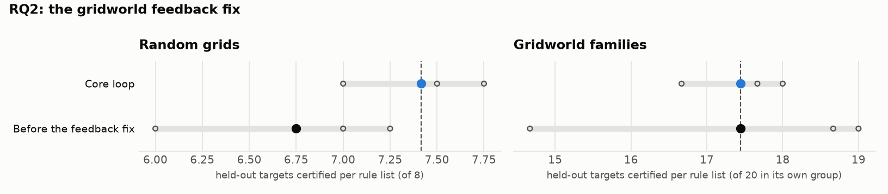

# RQ2: the gridworld feedback fix

How much does reading the sequence requirements by the goal flags add on the gridworld benchmarks? The core loop against the same loop before the fix, with Haiku 5.5.

Reference: **Core loop**. Certified: held-out targets certified per rule list (mean over runs, range over runs). Δ: difference of means to the reference, with a 90% bootstrap interval over runs (few runs: read it as a rough guide). Ties open: certified with the action orders left open, i.e. however ties are broken. Library: targets certified by at least one of a run's lists.

## Random grids

Targets 12-19 (each list's own training instances left out); certified of 8.

| condition | code | runs | certified | Δ vs reference | ties open | library | sets solved | rounds / set | output tokens / set |
|---|---|---|---|---|---|---|---|---|---|
| Core loop | Core | 3 | 7.42 (7.00–7.75) | reference | 7.33 (7.00–7.75) | 8.0 | 75% | 55.8 (55.2–56.0) | 126,846 (118,539–135,402) |
| Before the feedback fix | Unfixed | 3 | 6.75 (6.00–7.25) | -0.67 [-1.25, -0.08] | 6.50 (6.00–6.75) | 8.0 | 75% | 55.8 (55.5–56.0) | 120,256 (117,726–124,276) |

## Gridworld families

Targets 16-35,76-95,136-155 (each list's own training instances left out); certified of 20 in its own group.

| condition | code | runs | certified | Δ vs reference | ties open | library | sets solved | rounds / set | output tokens / set |
|---|---|---|---|---|---|---|---|---|---|
| Core loop | Core | 3 | 17.44 (16.67–18.00) | reference | 16.00 (15.33–16.33) | 58.7 (57.0–60.0) | 100% | 36.3 (34.7–37.7) | 74,055 (70,930–78,454) |
| Before the feedback fix | Unfixed | 3 | 17.44 (14.67–19.00) | +0.00 [-1.89, +1.78] | 16.33 (13.33–18.33) | 58.3 (56.0–60.0) | 100% | 41.3 (40.7–42.0) | 83,810 (80,670–86,859) |

Per group (certified per rule list on its own group, mean over runs):

| condition | rooms | crossing | adjacent |
|---|---|---|---|
| Core loop | 19.7 | 17.3 | 15.3 |
| Before the feedback fix | 16.0 | 18.3 | 18.0 |

