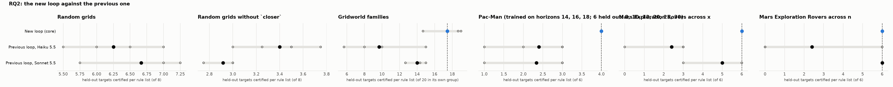

# RQ2: the new loop against the previous one

How much of the transfer comes from the rebuilt loop rather than the model? The previous loop with Haiku 5.5 and with Sonnet 5.5, against the new loop with Haiku 5.5.

Reference: **New loop (core)**. Certified: held-out targets certified per rule list (mean over runs, range over runs). Δ: difference of means to the reference, with a 90% bootstrap interval over runs (few runs: read it as a rough guide). Ties open: certified with the action orders left open, i.e. however ties are broken. Library: targets certified by at least one of a run's lists.

## Random grids

Targets 12-19 (each list's own training instances left out); certified of 8.

| condition | code | runs | certified | Δ vs reference | ties open | library | sets solved | rounds / set | output tokens / set |
|---|---|---|---|---|---|---|---|---|---|
| New loop (core) | New | 0 | – | – | – | – | – | – | – |
| Previous loop, Haiku 5.5 | Prev | 5 | 6.25 (5.50–7.00) | – | 5.20 (4.00–6.25) | 8.0 | 10% (0%–25%) | 4.9 (4.5–5.0) | 11,315 (8,570–15,009) |
| Previous loop, Sonnet 5.5 | Prev Sonnet | 3 | 6.67 (5.75–7.25) | – | 6.42 (5.50–7.00) | 8.0 | 75% | 2.8 (2.8–3.0) | 27,330 (22,730–35,251) |

## Random grids without `closer`

Targets 12-19 (each list's own training instances left out); certified of 8.

| condition | code | runs | certified | Δ vs reference | ties open | library | sets solved | rounds / set | output tokens / set |
|---|---|---|---|---|---|---|---|---|---|
| New loop (core) | New | 0 | – | – | – | – | – | – | – |
| Previous loop, Haiku 5.5 | Prev | 5 | 3.40 (3.00–3.75) | – | 0.00 | 6.0 (5.0–7.0) | 0% | 5.0 | 13,596 (12,449–15,153) |
| Previous loop, Sonnet 5.5 | Prev Sonnet | 3 | 2.92 (2.75–3.00) | – | 0.58 (0.50–0.75) | 6.3 (6.0–7.0) | 50% | 3.9 (3.8–4.0) | 54,993 (47,218–70,154) |

## Gridworld families

Targets 16-35,76-95,136-155 (each list's own training instances left out); certified of 20 in its own group.

| condition | code | runs | certified | Δ vs reference | ties open | library | sets solved | rounds / set | output tokens / set |
|---|---|---|---|---|---|---|---|---|---|
| New loop (core) | New | 3 | 17.44 (14.67–19.00) | reference | 16.33 (13.33–18.33) | 58.3 (56.0–60.0) | 100% | 41.3 (40.7–42.0) | 83,810 (80,670–86,859) |
| Previous loop, Haiku 5.5 | Prev | 5 | 9.67 (5.67–15.00) | -7.78 [-10.58, -4.64] | 3.07 (0.33–5.67) | 33.8 (24.0–56.0) | 40% (33%–67%) | 3.9 (3.7–4.3) | 9,947 (7,662–15,685) |
| Previous loop, Sonnet 5.5 | Prev Sonnet | 3 | 14.00 (12.67–15.00) | -3.44 [-5.44, -1.33] | 6.56 (5.67–7.33) | 54.3 (45.0–59.0) | 67% | 3.9 (3.7–4.3) | 44,195 (36,545–52,857) |

Per group (certified per rule list on its own group, mean over runs):

| condition | rooms | crossing | adjacent |
|---|---|---|---|
| New loop (core) | 16.0 | 18.3 | 18.0 |
| Previous loop, Haiku 5.5 | 8.4 | 4.6 | 16.0 |
| Previous loop, Sonnet 5.5 | 17.7 | 6.7 | 17.7 |

## Pac-Man (trained on horizons 14, 16, 18; 6 held out: 8, 10, 12, 20, 25, 30)

Targets 0-7,9 (each list's own training instances left out); certified of 6.

| condition | code | runs | certified | Δ vs reference | ties open | library | sets solved | rounds / set | output tokens / set |
|---|---|---|---|---|---|---|---|---|---|
| New loop (core) | New | 3 | 4.00 | reference | – | 4.0 | 100% | 44.0 (41.0–47.0) | 132,159 (124,660–138,919) |
| Previous loop, Haiku 5.5 | Prev | 5 | 2.40 (1.00–3.00) | -1.60 [-2.20, -1.00] | 2.40 (1.00–3.00) | 2.4 (1.0–3.0) | 40% (0%–100%) | 4.4 (3.0–5.0) | 5,712 (3,555–8,223) |
| Previous loop, Sonnet 5.5 | Prev Sonnet | 3 | 2.33 (1.00–3.00) | -1.67 [-2.33, -1.00] | 2.33 (1.00–3.00) | 2.3 (1.0–3.0) | 67% (0%–100%) | 3.3 (2.0–5.0) | 5,971 (2,663–10,242) |

## Mars Exploration Rovers across x

Targets 0-8 (each list's own training instances left out); certified of 6.

| condition | code | runs | certified | Δ vs reference | ties open | library | sets solved | rounds / set | output tokens / set |
|---|---|---|---|---|---|---|---|---|---|
| New loop (core) | New | 3 | 6.00 | reference | 6.00 | 6.0 | 100% | 55.0 (53.0–56.0) | 541,599 (473,278–592,054) |
| Previous loop, Haiku 5.5 | Prev | 5 | 2.40 (0.00–3.00) | -3.60 [-4.80, -3.00] | 2.40 (0.00–3.00) | 2.4 (0.0–3.0) | 0% | 5.0 | 44,329 (27,616–76,372) |
| Previous loop, Sonnet 5.5 | Prev Sonnet | 3 | 5.00 (3.00–6.00) | -1.00 [-2.00, +0.00] | 4.00 (3.00–6.00) | 5.0 (3.0–6.0) | 67% (0%–100%) | 3.0 (1.0–5.0) | 11,326 (4,345–17,062) |

## Mars Exploration Rovers across n

Targets 0-8 (each list's own training instances left out); certified of 6.

| condition | code | runs | certified | Δ vs reference | ties open | library | sets solved | rounds / set | output tokens / set |
|---|---|---|---|---|---|---|---|---|---|
| New loop (core) | New | 3 | 6.00 | reference | 6.00 | 6.0 | 100% | 45.3 (36.0–54.0) | 612,219 (423,413–804,754) |
| Previous loop, Haiku 5.5 | Prev | 5 | 2.40 (0.00–6.00) | -3.60 [-6.00, -1.20] | 2.40 (0.00–6.00) | 2.4 (0.0–6.0) | 40% (0%–100%) | 3.4 (1.0–5.0) | 31,516 (11,973–55,107) |
| Previous loop, Sonnet 5.5 | Prev Sonnet | 3 | 6.00 | +0.00 [+0.00, +0.00] | 6.00 | 6.0 | 100% | 2.7 (2.0–3.0) | 10,105 (6,595–12,773) |

