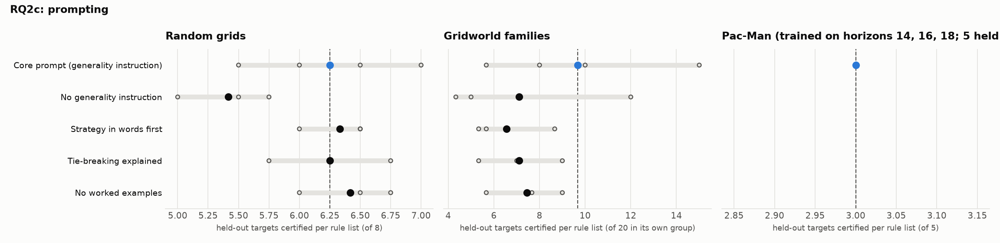

# RQ2c: prompting

Do changes to what the prompt asks for change how well the rules transfer?

Reference: **Core prompt (generality instruction)**. Certified: held-out targets certified per rule list (mean over runs, range over runs). Δ: difference of means to the reference, with a 90% bootstrap interval over runs (few runs: read it as a rough guide). Ties open: certified with the action orders left open, i.e. however ties are broken. Library: targets certified by at least one of a run's lists.

## Random grids

Targets 12-19 (each list's own training instances left out); certified of 8.

| condition | code | runs | certified | Δ vs reference | ties open | library | sets solved | rounds / set | output tokens / set |
|---|---|---|---|---|---|---|---|---|---|
| Core prompt (generality instruction) | Core | 5 | 6.25 (5.50–7.00) | reference | 5.50 (5.00–6.25) | 8.0 | 10% (0%–25%) | 4.9 (4.5–5.0) | 11,315 (8,570–15,009) |
| No generality instruction | No general | 3 | 5.42 (5.00–5.75) | -0.83 [-1.30, -0.37] | 3.92 (2.75–4.75) | 7.3 (7.0–8.0) | 8% (0%–25%) | 4.8 (4.5–5.0) | 11,554 (10,345–13,116) |
| Strategy in words first | Strategy | 3 | 6.33 (6.00–6.50) | +0.08 [-0.35, +0.50] | 4.58 (3.00–6.25) | 7.7 (7.0–8.0) | 17% (0%–25%) | 4.8 (4.5–5.0) | 10,072 (7,790–11,970) |
| Tie-breaking explained | Ties | 3 | 6.25 (5.75–6.75) | +0.00 [-0.53, +0.53] | 5.58 (4.75–6.00) | 7.3 (7.0–8.0) | 17% (0%–25%) | 4.7 (4.5–5.0) | 9,581 (8,317–11,639) |
| No worked examples | No examples | 3 | 6.42 (6.00–6.75) | +0.17 [-0.30, +0.62] | 5.67 (5.50–5.75) | 7.0 | 25% (0%–50%) | 4.7 (4.2–5.0) | 12,373 (11,038–13,388) |

## Gridworld families

Targets 16-35,76-95,136-155 (each list's own training instances left out); certified of 20 in its own group.

| condition | code | runs | certified | Δ vs reference | ties open | library | sets solved | rounds / set | output tokens / set |
|---|---|---|---|---|---|---|---|---|---|
| Core prompt (generality instruction) | Core | 5 | 9.67 (5.67–15.00) | reference | – | 33.8 (24.0–56.0) | 40% (33%–67%) | 3.9 (3.7–4.3) | 9,947 (7,662–15,685) |
| No generality instruction | No general | 3 | 7.11 (4.33–12.00) | -2.56 [-6.38, +1.51] | 1.44 (0.00–4.33) | 30.3 (24.0–38.0) | 56% (33%–67%) | 4.2 (3.7–4.7) | 20,521 (18,103–23,755) |
| Strategy in words first | Strategy | 3 | 6.56 (5.33–8.67) | -3.11 [-5.82, -0.44] | 0.33 (0.00–0.67) | 28.3 (24.0–37.0) | 11% (0%–33%) | 4.7 (4.0–5.0) | 11,136 (10,091–12,259) |
| Tie-breaking explained | Ties | 3 | 7.11 (5.33–9.00) | -2.56 [-5.27, +0.07] | 2.89 (1.33–4.33) | 26.7 (24.0–29.0) | 33% | 4.3 | 11,599 (9,872–13,537) |
| No worked examples | No examples | 3 | 7.44 (5.67–9.00) | -2.22 [-4.87, +0.29] | 0.00 | 25.7 (20.0–30.0) | 33% | 4.4 (4.0–5.0) | 12,581 (10,651–16,293) |

Per group (certified per rule list on its own group, mean over runs):

| condition | rooms | crossing | adjacent |
|---|---|---|---|
| Core prompt (generality instruction) | 8.4 | 4.6 | 16.0 |
| No generality instruction | 6.7 | 3.7 | 11.0 |
| Strategy in words first | 3.3 | 1.0 | 15.3 |
| Tie-breaking explained | 3.0 | 1.0 | 17.3 |
| No worked examples | 8.7 | 0.0 | 13.7 |

## Pac-Man (trained on horizons 14, 16, 18; 5 held out: 8, 10, 12, 20, 25)

Targets 0-7 (each list's own training instances left out); certified of 5.

| condition | code | runs | certified | Δ vs reference | ties open | library | sets solved | rounds / set | output tokens / set |
|---|---|---|---|---|---|---|---|---|---|
| Core prompt (generality instruction) | Core | 3 | 3.00 | reference | – | 3.0 | 67% (0%–100%) | 4.0 (3.0–5.0) | 4,649 (3,555–6,328) |
| No generality instruction | No general | 0 | – | – | – | – | – | – | – |
| Strategy in words first | Strategy | 0 | – | – | – | – | – | – | – |
| Tie-breaking explained | Ties | 0 | – | – | – | – | – | – | – |
| No worked examples | No examples | 0 | – | – | – | – | – | – | – |

