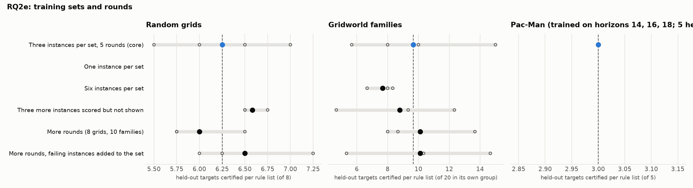

# RQ2e: training sets and rounds

Does training a rule list on more instances, or for longer, make it transfer better?

Reference: **Three instances per set, 5 rounds (core)**. Certified: held-out targets certified per rule list (mean over runs, range over runs). Δ: difference of means to the reference, with a 90% bootstrap interval over runs (few runs: read it as a rough guide). Ties open: certified with the action orders left open, i.e. however ties are broken. Library: targets certified by at least one of a run's lists.

## Random grids

Targets 12-19 (each list's own training instances left out); certified of 8.

| condition | code | runs | certified | Δ vs reference | ties open | library | sets solved | rounds / set | output tokens / set |
|---|---|---|---|---|---|---|---|---|---|
| Three instances per set, 5 rounds (core) | Core | 5 | 6.25 (5.50–7.00) | reference | 5.50 (5.00–6.25) | 8.0 | 10% (0%–25%) | 4.9 (4.5–5.0) | 11,315 (8,570–15,009) |
| One instance per set | One | 0 | – | – | – | – | – | – | – |
| Six instances per set | Six | 0 | – | – | – | – | – | – | – |
| Three more instances scored but not shown | Hidden | 3 | 6.58 (6.50–6.75) | +0.33 [-0.05, +0.72] | – | 7.7 (7.0–8.0) | 0% | 5.0 | 10,170 (8,684–12,416) |
| More rounds (8 grids, 10 families) | Rounds | 3 | 6.00 (5.75–6.50) | -0.25 [-0.75, +0.25] | – | 7.7 (7.0–8.0) | 17% (0%–25%) | 7.7 (7.2–8.0) | 18,524 (17,479–20,432) |
| More rounds, failing instances added to the set | Grow | 3 | 6.50 (6.00–7.25) | +0.25 [-0.37, +0.90] | – | 7.7 (7.0–8.0) | 0% | 8.0 | 20,577 (19,729–21,644) |

## Gridworld families

Targets 16-35,76-95,136-155 (each list's own training instances left out); certified of 20 in its own group.

| condition | code | runs | certified | Δ vs reference | ties open | library | sets solved | rounds / set | output tokens / set |
|---|---|---|---|---|---|---|---|---|---|
| Three instances per set, 5 rounds (core) | Core | 5 | 9.67 (5.67–15.00) | reference | – | 33.8 (24.0–56.0) | 40% (33%–67%) | 3.9 (3.7–4.3) | 9,947 (7,662–15,685) |
| One instance per set | One | 0 | – | – | – | – | – | – | – |
| Six instances per set | Six | 3 | 7.67 (6.67–8.33) | -2.00 [-4.42, +0.27] | – | 29.0 (26.0–31.0) | 33% | 3.8 (3.7–4.0) | 7,207 (5,932–8,499) |
| Three more instances scored but not shown | Hidden | 3 | 8.78 (4.67–12.33) | -0.89 [-4.76, +2.80] | – | 29.0 (20.0–38.0) | 44% (33%–67%) | 4.2 (3.0–5.0) | 9,041 (5,075–11,162) |
| More rounds (8 grids, 10 families) | Rounds | 3 | 10.11 (8.00–13.67) | +0.44 [-2.82, +3.73] | – | 34.7 (29.0–44.0) | 33% | 7.9 (7.7–8.3) | 22,610 (16,382–28,906) |
| More rounds, failing instances added to the set | Grow | 3 | 10.11 (5.33–14.67) | +0.44 [-3.89, +4.71] | – | 35.0 (25.0–46.0) | 11% (0%–33%) | 9.7 (9.0–10.0) | 31,518 (25,169–38,725) |

Per group (certified per rule list on its own group, mean over runs):

| condition | rooms | crossing | adjacent |
|---|---|---|---|
| Three instances per set, 5 rounds (core) | 8.4 | 4.6 | 16.0 |
| One instance per set | – | – | – |
| Six instances per set | 4.7 | 4.3 | 14.0 |
| Three more instances scored but not shown | 10.3 | 0.0 | 16.0 |
| More rounds (8 grids, 10 families) | 9.3 | 4.7 | 16.3 |
| More rounds, failing instances added to the set | 8.0 | 6.3 | 16.0 |

## Pac-Man (trained on horizons 14, 16, 18; 5 held out: 8, 10, 12, 20, 25)

Targets 0-7 (each list's own training instances left out); certified of 5.

| condition | code | runs | certified | Δ vs reference | ties open | library | sets solved | rounds / set | output tokens / set |
|---|---|---|---|---|---|---|---|---|---|
| Three instances per set, 5 rounds (core) | Core | 3 | 3.00 | reference | – | 3.0 | 67% (0%–100%) | 4.0 (3.0–5.0) | 4,649 (3,555–6,328) |

