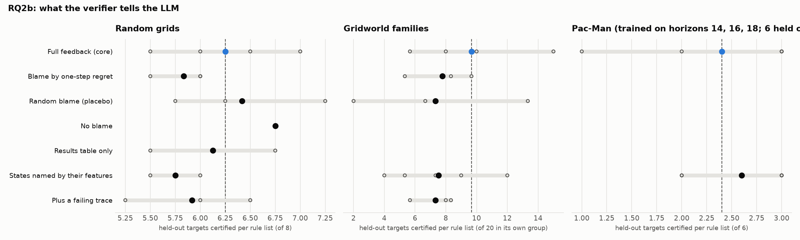

# RQ2b: what the verifier tells the LLM

Which parts of the verifier's output help the LLM write rules that transfer?

Reference: **Full feedback (core)**. Certified: held-out targets certified per rule list (mean over runs, range over runs). Δ: difference of means to the reference, with a 90% bootstrap interval over runs (few runs: read it as a rough guide). Ties open: certified with the action orders left open, i.e. however ties are broken. Library: targets certified by at least one of a run's lists.

## Random grids

Targets 12-19 (each list's own training instances left out); certified of 8.

| condition | code | runs | certified | Δ vs reference | ties open | library | sets solved | rounds / set | output tokens / set |
|---|---|---|---|---|---|---|---|---|---|
| Full feedback (core) | Full | 5 | 6.25 (5.50–7.00) | reference | 5.50 (5.00–6.25) | 8.0 | 10% (0%–25%) | 4.9 (4.5–5.0) | 11,315 (8,570–15,009) |
| Blame by one-step regret | Regret | 3 | 5.83 (5.50–6.00) | -0.42 [-0.87, +0.00] | 4.58 (3.75–5.25) | 8.0 | 8% (0%–25%) | 4.8 (4.2–5.0) | 8,100 (6,037–9,722) |
| Random blame (placebo) | Random | 3 | 6.42 (5.75–7.25) | +0.17 [-0.52, +0.87] | 5.88 (5.50–6.25) | 8.0 | 8% (0%–25%) | 5.0 | 8,199 (7,158–9,660) |
| No blame | No blame | 1 | 6.75 | +0.50 [+0.15, +0.85] | 6.00 | 8.0 | 25% | 4.2 | 8,890 |
| Results table only | Table | 2 | 6.12 (5.50–6.75) | -0.12 [-0.95, +0.70] | 5.25 | 7.0 (6.0–8.0) | 12% (0%–25%) | 4.6 (4.2–5.0) | 6,676 (5,547–7,805) |
| States named by their features | Feature space | 5 | 5.75 (5.50–6.00) | -0.50 [-0.90, -0.10] | 4.30 (3.75–5.00) | 8.0 | 5% (0%–25%) | 5.0 | 10,834 (9,866–13,117) |
| Plus a failing trace | Trace | 3 | 5.92 (5.25–6.50) | -0.33 [-0.95, +0.27] | – | 8.0 | 25% | 4.7 (4.5–5.0) | 9,500 (7,462–12,570) |

## Gridworld families

Targets 16-35,76-95,136-155 (each list's own training instances left out); certified of 20 in its own group.

| condition | code | runs | certified | Δ vs reference | ties open | library | sets solved | rounds / set | output tokens / set |
|---|---|---|---|---|---|---|---|---|---|
| Full feedback (core) | Full | 5 | 9.67 (5.67–15.00) | reference | – | 33.8 (24.0–56.0) | 40% (33%–67%) | 3.9 (3.7–4.3) | 9,947 (7,662–15,685) |
| Blame by one-step regret | Regret | 3 | 7.78 (5.33–9.67) | -1.89 [-4.80, +0.84] | 0.33 | 30.0 (24.0–36.0) | 0% | 5.0 | 10,618 (8,545–12,570) |
| Random blame (placebo) | Random | 3 | 7.33 (2.00–13.33) | -2.33 [-7.31, +2.56] | 3.00 (0.00–4.67) | 30.0 (22.0–41.0) | 33% | 4.1 (4.0–4.3) | 7,897 (6,781–9,393) |
| No blame (1 unchecked) | No blame | 1 | – | – | – | – | 33% | 3.7 | 14,686 |
| Results table only | Table | 0 | – | – | – | – | – | – | – |
| States named by their features | Feature space | 5 | 7.53 (4.00–12.00) | -2.13 [-5.20, +1.00] | 1.60 (0.00–5.00) | 30.4 (23.0–43.0) | 33% | 4.3 (3.7–5.0) | 9,416 (7,164–13,912) |
| Plus a failing trace | Trace | 3 | 7.33 (5.67–8.33) | -2.33 [-4.98, +0.07] | – | 28.7 (27.0–32.0) | 11% (0%–33%) | 4.8 (4.3–5.0) | 17,565 (13,475–21,488) |

Per group (certified per rule list on its own group, mean over runs):

| condition | rooms | crossing | adjacent |
|---|---|---|---|
| Full feedback (core) | 8.4 | 4.6 | 16.0 |
| Blame by one-step regret | 6.3 | 1.3 | 15.7 |
| Random blame (placebo) | 7.0 | 1.7 | 13.3 |
| No blame | – | – | – |
| Results table only | – | – | – |
| States named by their features | 6.8 | 2.8 | 13.0 |
| Plus a failing trace | 7.3 | 0.0 | 14.7 |

## Pac-Man (trained on horizons 14, 16, 18; 6 held out: 8, 10, 12, 20, 25, 30)

Targets 0-7,9 (each list's own training instances left out); certified of 6.

| condition | code | runs | certified | Δ vs reference | ties open | library | sets solved | rounds / set | output tokens / set |
|---|---|---|---|---|---|---|---|---|---|
| Full feedback (core) | Full | 5 | 2.40 (1.00–3.00) | reference | 2.40 (1.00–3.00) | 2.4 (1.0–3.0) | 40% (0%–100%) | 4.4 (3.0–5.0) | 5,712 (3,555–8,223) |
| Blame by one-step regret | Regret | 0 | – | – | – | – | – | – | – |
| Random blame (placebo) | Random | 0 | – | – | – | – | – | – | – |
| No blame | No blame | 0 | – | – | – | – | – | – | – |
| Results table only | Table | 0 | – | – | – | – | – | – | – |
| States named by their features | Feature space | 5 | 2.60 (2.00–3.00) | +0.20 [-0.40, +1.00] | 2.60 (2.00–3.00) | 2.6 (2.0–3.0) | 60% (0%–100%) | 4.0 (2.0–5.0) | 4,848 (1,904–7,291) |
| Plus a failing trace | Trace | 0 | – | – | – | – | – | – | – |

