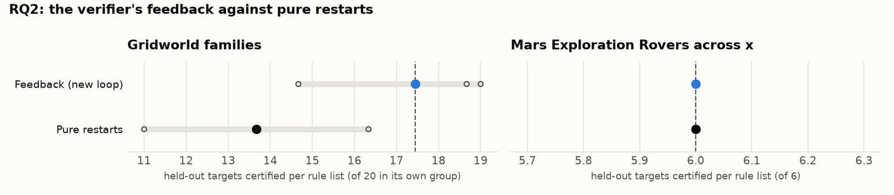

# RQ2: the verifier's feedback against pure restarts

Does the verifier's feedback beat resampling the initial prompt? The new loop against the same loop with pure restarts (`port_*_resample`), on the gridworld families and MER across x. Restarts' prompts carry no failure report or attempt history, so they cost less per training set (families $0.050 against $0.074, MER $0.283 against $0.337) for about as many LLM calls. The feedback runs predate the fix of the failure feedback on gridworld (`feedback.history`, Oct 16), so up to a fifth of their failure locations were misleading.

Reference: **Feedback (new loop)**. Certified: held-out targets certified per rule list (mean over runs, range over runs). Δ: difference of means to the reference, with a 90% bootstrap interval over runs (few runs: read it as a rough guide). Ties open: certified with the action orders left open, i.e. however ties are broken. Library: targets certified by at least one of a run's lists.

## Gridworld families

Targets 16-35,76-95,136-155 (each list's own training instances left out); certified of 20 in its own group.

| condition | code | runs | certified | Δ vs reference | ties open | library | sets solved | rounds / set | output tokens / set |
|---|---|---|---|---|---|---|---|---|---|
| Feedback (new loop) | Fb | 3 | 17.44 (14.67–19.00) | reference | 16.33 (13.33–18.33) | 58.3 (56.0–60.0) | 100% | 41.3 (40.7–42.0) | 83,810 (80,670–86,859) |
| Pure restarts | Restarts | 3 | 13.67 (11.00–16.33) | -3.78 [-6.44, -1.00] | 13.22 (11.00–16.33) | 44.3 (36.0–56.0) | 100% | 42.0 | 56,627 (55,772–57,815) |

Per group (certified per rule list on its own group, mean over runs):

| condition | rooms | crossing | adjacent |
|---|---|---|---|
| Feedback (new loop) | 16.0 | 18.3 | 18.0 |
| Pure restarts | 10.7 | 12.7 | 17.7 |

## Mars Exploration Rovers across x

Targets 0-8 (each list's own training instances left out); certified of 6.

| condition | code | runs | certified | Δ vs reference | ties open | library | sets solved | rounds / set | output tokens / set |
|---|---|---|---|---|---|---|---|---|---|
| Feedback (new loop) | Fb | 3 | 6.00 | reference | 6.00 | 6.0 | 100% | 55.0 (53.0–56.0) | 541,599 (473,278–592,054) |
| Pure restarts | Restarts | 3 | 6.00 | +0.00 [+0.00, +0.00] | 6.00 | 6.0 | 100% | 51.7 (49.0–55.0) | 468,313 (430,614–502,040) |

